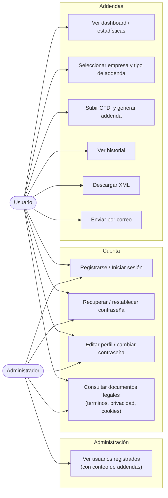

# Diagrama de casos de uso

Actores: **Usuario** (genera addendas) y **Administrador** (supervisa; no genera addendas).

> Notas:
>
> - Las empresas y sus tipos de addenda (`configuracion_campos`) los da de alta el desarrollador directamente en la BD; ningún actor tiene un caso de uso de alta/edición desde la UI todavía.
> - El Administrador solo tiene acceso de lectura al listado de usuarios (`/admin/usuarios`); no hay gestión de empresas ni edición de otros usuarios implementada.
