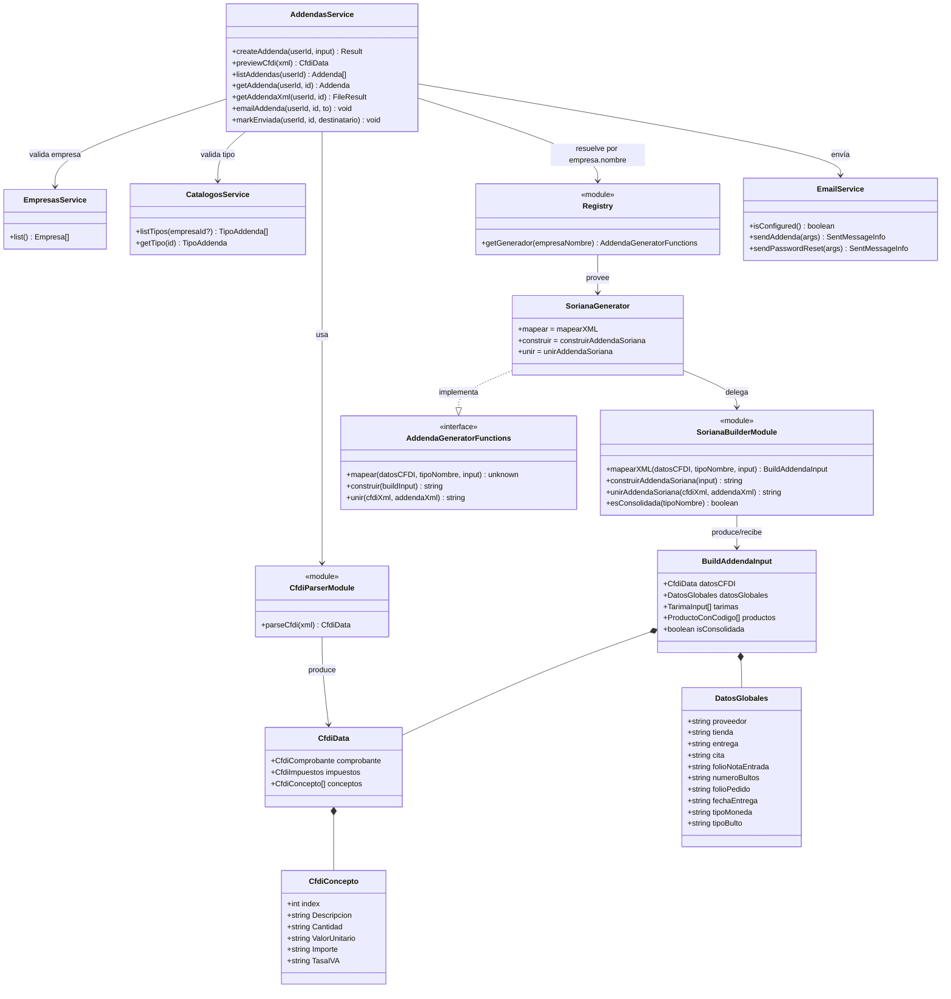

# Diagrama de clases (dominio de generación de addendas)

Estructura por módulos del backend (servicios `@Injectable` de NestJS) y el núcleo de generación (parser + generadores por empresa). Los generadores no son clases: son funciones agrupadas que implementan la interfaz `AddendaGeneratorFunctions`; se modelan aquí como "clases" solo para mostrar su contrato.

